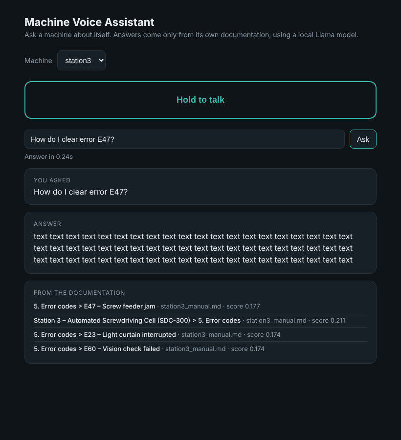

# Audio RAG – Ask a machine about itself, by voice

A voice assistant for machines and vehicles. You load it with a machine's own documentation (manuals, specifications, maintenance records). A technician asks a question out loud, for example *"How do I clear error E47?"*, and gets a short spoken answer that comes only from that documentation.

Everything runs **locally**: speech recognition, search and the language model. No machine data leaves the device, which matters for industrial customers.

```
 🎤 voice ──► Whisper ──► question ──► ChromaDB search ──► top chunks ──► Llama 3 ──► answer ──► Piper ──► 🔊
           (speech-to-text)          (vector database)                 (via Ollama)          (text-to-speech)
```



## Features

- **Push-to-talk voice assistant** in the terminal, and a **web demo** (hold the button and speak)
- **Answers only from the documentation.** If the answer isn't there, it says so instead of guessing
- **Hybrid search:** vector search plus an exact-match boost for codes like `E47`, so error codes are never confused
- **Fixes misheard codes** ("air Re47" → "error E47") before searching
- **Shows its sources** (file and section) for every answer
- **Add a machine from the browser:** choose a folder or files, and it learns them right away
- **One folder per machine** (`data/station3/`, `data/truck_x/`, …), each with its own vector collection
- **Machine-specific speech hints** so Whisper hears "E47" correctly
- **REST API** (FastAPI) for integration into an HMI, an app or a vehicle system
- **Evaluation script** that measures retrieval hit rate, answer accuracy and response time

## Tech stack

| Part | Tool |
|---|---|
| Speech-to-text | [faster-whisper](https://github.com/SYSTRAN/faster-whisper) |
| RAG framework | [LlamaIndex](https://www.llamaindex.ai/) |
| Vector database | [ChromaDB](https://www.trychroma.com/) |
| LLM + embeddings | Llama 3 and nomic-embed-text via [Ollama](https://ollama.com/) |
| Text-to-speech | [Piper](https://github.com/OHF-Voice/piper1-gpl) |
| API | FastAPI |

## Setup (macOS)

1. Install [Ollama](https://ollama.com/download) and open it once.
2. In this folder, run:
   ```bash
   bash scripts/setup_mac.sh
   ```
   This creates a Python environment, downloads Llama 3, the embedding model and a Piper voice, and loads the sample manual.

On a Mac with 8 GB RAM, use the smaller model: `AUDIO_RAG_LLM=llama3.2:3b bash scripts/setup_mac.sh` (and set the same variable when you run it).

## Usage

```bash
source .venv/bin/activate

# Ask one question as text
python -m audio_rag.cli ask station3 "How do I clear error E47?"

# Type questions in a loop
python -m audio_rag.cli chat station3

# Talk to the machine (press Enter to start and stop speaking)
python -m audio_rag.cli voice station3

# Web demo: hold the button (or the space bar) and speak
uvicorn audio_rag.api:app
# open http://localhost:8000
```

## Add your own machine

**In the web demo:** open *Add documents for a machine*, type a name, click **Choose folder** (or **Choose files**) and then **Upload and learn**. The assistant is ready for questions a few seconds later.

**From the command line:**

1. Create a folder, for example `data/forklift/`, and put its documents in it (`.pdf`, `.md`, `.txt`, `.docx`).
2. Optional: add `data/forklift/whisper_hints.txt` with error codes and part names, so speech recognition gets them right.
3. Load it:
   ```bash
   python -m audio_rag.cli ingest forklift
   ```

## Evaluation

```bash
python scripts/evaluate.py station3
```

Runs the test questions in `eval/station3.json` and reports:
- **Retrieval hit rate:** did the search find the right section?
- **Answer keyword match:** does the answer contain the key fact?
- **Average answer time**

The test set includes a question that is *not* in the manual, to check that the assistant says "I can't find that" instead of making something up.

## Tests

Fast tests that need no Ollama, microphone or downloaded models:

```bash
pip install pytest
AUDIO_RAG_MOCK=1 pytest -q
```

## Settings

All settings are environment variables (see `audio_rag/config.py`):

| Variable | Default | Meaning |
|---|---|---|
| `AUDIO_RAG_LLM` | `llama3.1:8b` | Ollama model for answers |
| `AUDIO_RAG_EMBED` | `nomic-embed-text` | Ollama embedding model |
| `AUDIO_RAG_WHISPER` | `base` | Whisper size: `tiny`, `base`, `small`, `medium` |
| `AUDIO_RAG_LANGUAGE` | `en` | Spoken language (`de` for German) |
| `AUDIO_RAG_TOP_K` | `4` | How many document chunks the model sees |
| `AUDIO_RAG_PIPER_VOICE` | `voices/en_US-lessac-medium.onnx` | Piper voice file |

## Project structure

```
audio_rag/
  config.py      settings
  rag.py         ingestion (documents → chunks → ChromaDB) and question answering
  voice.py       microphone, Whisper, Piper
  cli.py         command line: ingest, ask, chat, voice
  api.py         FastAPI + web demo
  static/        web demo page
data/station3/   sample machine manual (fictional) + speech hints
eval/            test questions
scripts/         setup and evaluation
```

## Roadmap

- [ ] Wake word ("Hey Station 3") instead of push-to-talk
- [ ] German voice and German manuals
- [ ] Answers with page numbers for PDF manuals
- [ ] Run on an edge device (Raspberry Pi 5 / Jetson) inside a machine cabinet
- [ ] Combine documentation with live machine data (current error code, counters)

## Note

The sample manual in `data/station3/` describes a fictional machine. All values are made up for the demo.
